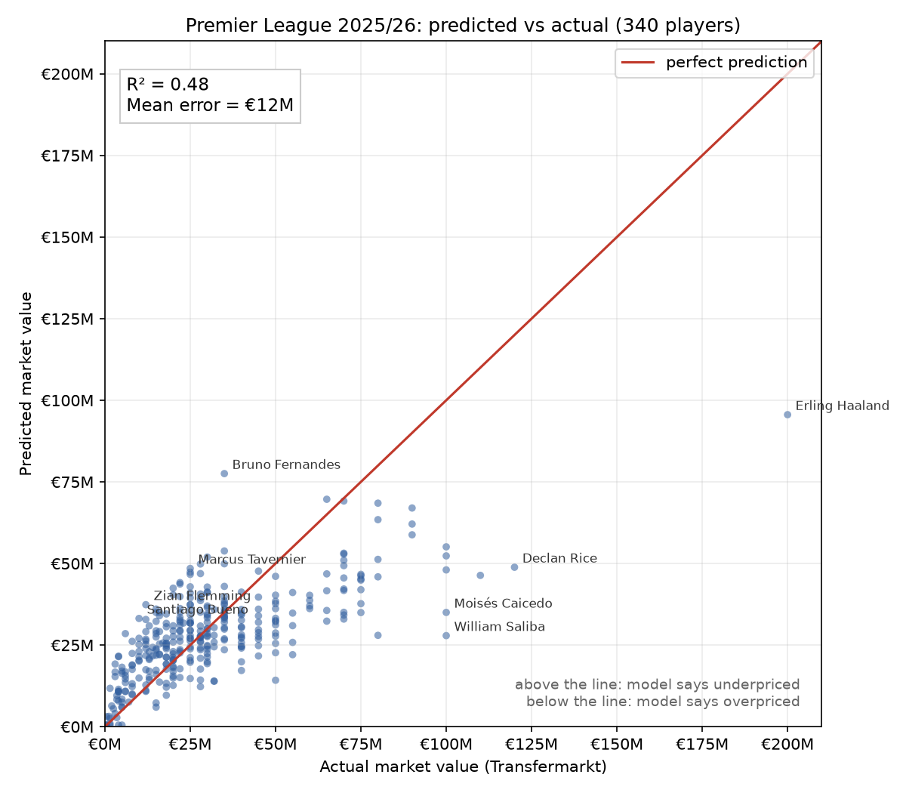

# Value IQ: Premier League player value predictor

A linear regression that looks at a Premier League player's season (goals, assists,
minutes, age, position) and predicts his transfer market value. Compare the prediction
with his real Transfermarkt value and you get a verdict: **overpriced**, **underpriced**
or **fairly priced**.



## Run it

```bash
pip install -r requirements.txt
python run_all.py
```

Then open `output/dashboard.html` in your browser. The same page is copied to
`docs/index.html`, which GitHub Pages publishes. To count visitors, put your
[GoatCounter](https://www.goatcounter.com/) code in `GOATCOUNTER_CODE` in `config.py`
and run `python make_dashboard.py` again.

Or run the steps one by one:

| Step | Script | Tool | What it does |
|---|---|---|---|
| 1 | `fetch_data.py` | requests | Downloads ~60 MB of open Transfermarkt data |
| 2 | `build_dataset.py` | pandas | One row per player per season, 2019/20 to the latest finished season |
| 3 | `train_model.py` | scikit-learn, matplotlib | Fits the model, tests it, saves `model.json` and the chart |
| 4 | `predict.py` | | Plug in any player or your own numbers |
| 5 | `make_dashboard.py` | | Builds the interactive dashboard |

```bash
python predict.py "Bukayo Saka"
python predict.py "Saka" --season 2023/24
python predict.py --goals 15 --assists 8 --minutes 2800 --age 22 --position FWD
```

## The model

Features (in `config.py`):

| Idea | Feature(s) |
|---|---|
| Goals | season total and goals per 90 minutes |
| Assists | season total |
| Minutes played | season total, i.e. how available he is |
| Age | years before the peak age of 27 and years after it, treated separately, because being young adds value and being old removes it |
| Position | defender / midfielder / forward flags (goalkeeper is the baseline) |
| Season | the starting year, which captures transfer-market inflation |

The target is the player's most recent Transfermarkt value on or before 1 August after the
season. For 2025/26 that means values as of June 2026, when the dataset stopped updating.
Only players with at least 900 league minutes count.

**How it's tested:** the model trains on every season except the latest one, then predicts
the held-out latest season. Many of those players also appear in earlier training seasons,
so this tests a new season, not unseen players. On 2025/26 it scores **R² = 0.48** with a
mean error of about **€12M**. In plain words, the five stats explain about half of why one player costs
more than another.

The other half is everything the stats leave out: the club, potential, defensive work,
contract length, reputation, nationality. That's why Haaland (€200M) is "overpriced"
at €96M. The market pays for things these numbers can't see. Good next steps if you want
to improve it: add the club's league position, expected goals (xG), contract years left,
or try a tree model such as `RandomForestRegressor`.

**Reading the coefficients:** the forward flag comes out *negative*. That isn't saying
forwards are cheap. The goal features already credit forwards for scoring, so the flag
only corrects what's left over. Linear models share credit between related features
like this, which is worth keeping in mind before you read too much into one number.

## Data

[transfermarkt-datasets](https://github.com/dcaribou/transfermarkt-datasets) by David Cariboo:
open data scraped from Transfermarkt. No API key needed. Its updates have been paused since
mid-2026 ([discussion #383](https://github.com/dcaribou/transfermarkt-datasets/discussions/383)),
so market values end in June 2026 and the 2026/27 season isn't included.

## How this was built

- **Idea:** adapted from "project 1" in a short social-media video suggesting three
  Premier League coding projects.
- **First version:** the code and the dashboard were written with Claude (Anthropic),
  an AI coding assistant, on 25 October 2026.
- **Changes since the first version:** none yet. Every later change is in the commit history.

football-data.org (the source the original video suggests) has goals and squads, but no
market values, so it can't supply what this model predicts.
